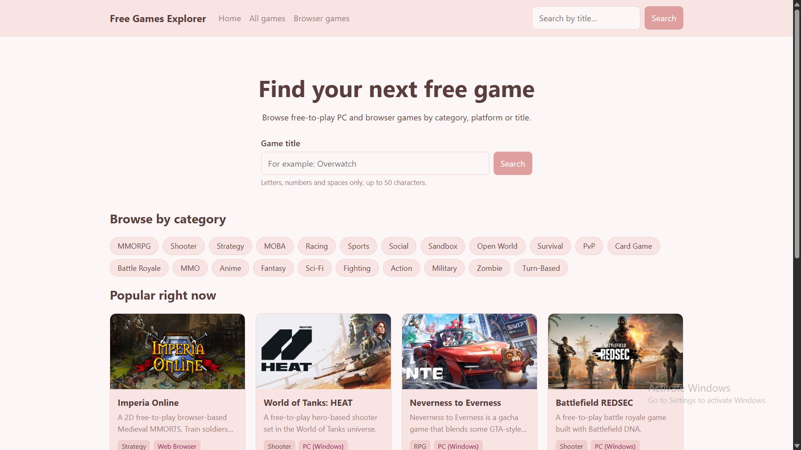
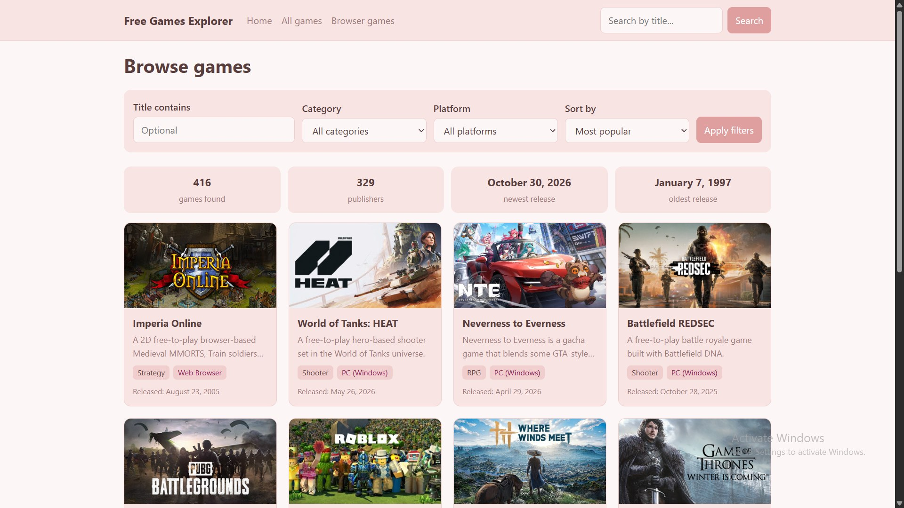
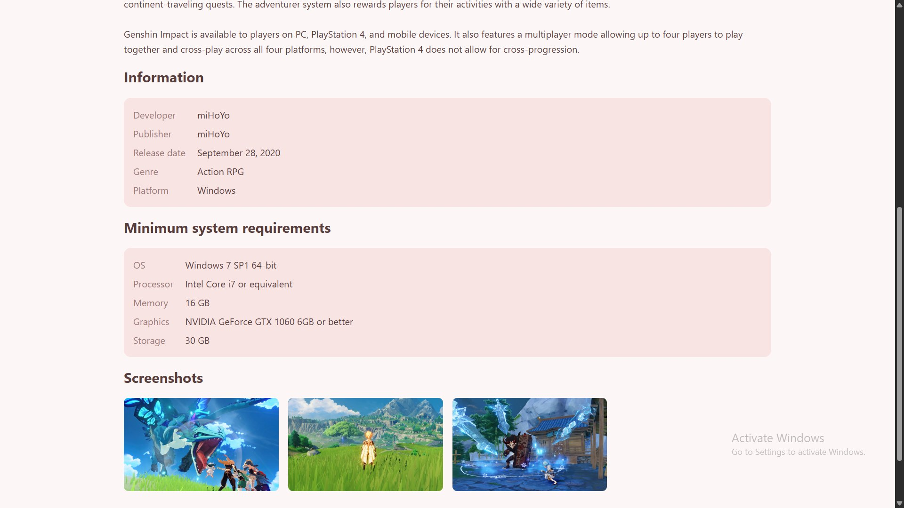

# Free Games Explorer

A website where you can find free games to play. You can browse games by category and platform, search by title, and open a page with details about each game.

Made for the course **VR 113153 Web Development II** with Node.js, Express, Axios and EJS.

## What it does

- Shows popular free games on the home page
- Lets you filter games by category and platform
- Lets you sort games (most popular, newest, A to Z)
- Lets you search games by title
- Shows a details page for each game: description, developer, publisher, release date, system requirements and screenshots
- Shows simple statistics for the results (number of games, publishers, newest and oldest release)
- Splits long lists into pages (12 games per page)
- Checks everything the user types before using it
- Shows friendly error messages if something goes wrong (no internet, slow API, too many requests, no results)
- Has a custom 404 page
- Remembers API answers for 5 minutes, so the site sends fewer requests
- Works on desktop and mobile

## API used

**FreeToGame API**: https://www.freetogame.com/api-doc

It is free and does not need an API key. The project uses two requests:

| Request | What it does |
|---|---|
| `GET /games` (with `category`, `platform`, `sort-by`) | gets a list of games |
| `GET /game?id=...` | gets details of one game |

The API cannot search by title, so the server gets the list and filters it by title itself.

## Routes

| Method | URL | What it does |
|---|---|---|
| GET | `/` | Home page |
| GET | `/games` | List of games. Optional: `category`, `platform`, `sort`, `q`, `page` |
| GET | `/search?q=...` | Search by title (`q` is required) |
| GET | `/game/:id` | Details of one game |
| any | other URLs | 404 page |

## Project structure

```
free-games-explorer/
├── app.js                  # starts the server, sets up middleware and routes
├── routes/                 # connects URLs to controllers
├── controllers/            # handles requests and processes data
├── services/               # talks to the FreeToGame API with Axios
├── middleware/             # logger, validation, 404 page, error handler
├── config/options.js       # allowed categories, platforms and sort options
├── utils/AppError.js       # custom error with a status code and a friendly message
├── views/                  # EJS pages and partials (header, footer, game card)
├── public/                 # CSS and images
├── .env.example
├── .gitignore
└── package.json
```

## How to install and run

You need Node.js 18 or newer.

1. Install the packages:
   ```bash
   npm install
   ```
2. Create your `.env` file from the example:
   ```bash
   cp .env.example .env
   ```
   On Windows (cmd), use `copy .env.example .env`.
3. Start the server:
   ```bash
   npm start
   ```
4. Open http://localhost:3000 in your browser.

### Settings in `.env`

| Name | Default | Meaning |
|---|---|---|
| `PORT` | 3000 | port of the server |
| `API_BASE_URL` | https://www.freetogame.com/api | address of the API |
| `REQUEST_TIMEOUT_MS` | 10000 | how long to wait for the API (in milliseconds) |
| `CACHE_TTL_SECONDS` | 300 | how long to keep API answers (in seconds) |

## Screenshots





## Credits

- Game data and images: [FreeToGame.com](https://www.freetogame.com)
- Documentation used: Express, Axios, EJS and dotenv official docs
- Some parts of the code were made with AI help (Claude and Gemini). See `AI_DECLARATION.md`.
